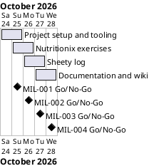

# Project Plan

## Metadata
| Key | Value |
| --- | --- |
| ID | PP-001 |
| CrossReference | [BC-001], [SA-001], [MIL-001], [MIL-002], [MIL-003], [MIL-004] |
| Language | en |
| Domain | it |

## Version History
| Date | Status | Author | Reviewer | Change | Commit |
| --- | --- | --- | --- | --- | --- |
| 2026-10-24 | Deprecated | Jens Tirsvad Nielsen | S01 | Initial version, accepted by S01 in chat on 2026-10-24 | [b64ad78] |
| 2026-10-24 | Accepted | Jens Tirsvad Nielsen | AI as stand-in for S01 | Final state: milestone links and open issues of the wiki | pending |

---

## Purpose

The plan schedules the four gateways that take the Exercise Tracker from an empty repository to a documented project, within the two-day effort and the one-branch-per-milestone constraint of [BC-001].

## Planning Assumptions

- The plan starts on 2026-10-24 and ends by 2026-10-28, per the Business Case constraint of about two days of work spread over a few days.
- One gateway is built on one branch and merged by one pull request, so the steps stay traceable. The documents of the plan itself are merged first, by a plan pull request that closes no issue.
- S01 accepts the plan in chat (autonomous mode); the AI reviews each artifact as stand-in for S01 and records it as not independent.
- The milestones are published to the git host by `sync-project.sh --apply` after the plan is accepted, because the project does not install the framework's publish-milestones workflow.
- The repository is the `origin` of this clone, `Tirsvad-Udemy-100-days-of-code/038-nutritionix`.

## Gateway Schedule

| Gateway | Document | Window | Decision date | Owner | Stories | Main deliverable | Milestone |
| --- | --- | --- | --- | --- | --- | --- | --- |
| Project setup and tooling | [MIL-001] | 2026-10-24 to 2026-10-25 | 2026-10-25 | S01 | none (ADR-0002) | pyproject, .gitignore, Doxyfile, constants.py, first README, workflows, description and topics | [MIL-001 milestone] |
| Nutritionix exercises | [MIL-002] | 2026-10-25 to 2026-10-26 | 2026-10-26 | S01 | none (ADR-0002) | `get_exercises`, layers, adapters, configuration | [MIL-002 milestone] |
| Sheety log | [MIL-003] | 2026-10-26 to 2026-10-27 | 2026-10-27 | S01 | none (ADR-0002) | `add_workout_row`, authentication, `log` command | [MIL-003 milestone] |
| Documentation and wiki | [MIL-004] | 2026-10-27 to 2026-10-28 | 2026-10-28 | S01 | none (ADR-0002) | README, screenshots, wiki in three languages, Doxygen | [MIL-004 milestone] |



## Scope Coverage

| Business Case scope item | Gateway |
| --- | --- |
| Python 3.13+, `.venv`, `pyproject.toml`, `.gitignore`, pytest | [MIL-001] |
| Query to Nutritionix and parsing of its exercises | [MIL-002] |
| One Sheety POST per exercise with bearer or basic authentication | [MIL-003] |
| Command line with dry run | [MIL-002], [MIL-003] |
| `constants.py`, Doxygen comments, `Doxyfile` | [MIL-001], [MIL-004] |
| README from the framework template, wiki in three languages, screenshots | [MIL-004] |
| Shared workflows, description and topics | [MIL-001], [MIL-004] |

## Dependencies

```
MIL-001 → MIL-002 → MIL-003 → MIL-004
```

A No-Go on a gateway moves every later date by the time of the rework; the end date 2026-10-28 is then renegotiated with S01.

## Plan Risks

| Risk | Impact | Mitigation |
| --- | --- | --- |
| The shared workflows cannot run because the runner or the secrets are missing | The checks stay unproven in CI | The same checks run locally before each pull request and the missing secrets are listed in the README and in the run summary |
| The Bahasa Malaysia and Danish translations are not read by a native speaker | Wrong wording | The records of the language checks stay `Go-with-conditions` until a person who reads the language has checked them |
| `doxygen` is not installed on the author's machine | The Doxygen criterion cannot be checked | The run uses a portable binary if available, otherwise the criterion is reported as not verified |

## Open Issues

- The repository named in the brief (`Tirsvad-Udemy-100_days_of_code`) differs from the `origin` of this clone; the plan uses the `origin`. S01 may redirect it.
- The Sheety endpoint is not in the brief, so `SHEET_ENDPOINT` in the personal `.env` is empty and no live call is made.
- The secret `TOKEN_FOR_GITEA_WIKI` is not set by the AI; S01 sets it in the organisation before the wiki can be published.
- No live call to Nutritionix or Sheety is made; the screenshots show the dry run and the tests.
- The Danish and Bahasa Malaysia wiki pages were written by the AI; no native-speaker review is recorded.
- The wiki publish workflow was installed in MIL-001 together with the other workflows, so task 5 of MIL-004 needed no change.

---

[BC-001]: ./business-case.md
[SA-001]: ./stakeholder-analysis.md
[MIL-001]: ./milestones/mil-001-project-setup.md
[MIL-002]: ./milestones/mil-002-nutritionix-exercises.md
[MIL-003]: ./milestones/mil-003-sheety-log.md
[MIL-004]: ./milestones/mil-004-docs-and-wiki.md
[b64ad78]: https://git.tirsystem.com/Tirsvad-Udemy-100-days-of-code/038-nutritionix/commit/b64ad78da4e7a2bd6357aebc7435f940aabd3474
[MIL-001 milestone]: https://git.tirsystem.com/Tirsvad-Udemy-100-days-of-code/038-nutritionix/milestone/233
[MIL-002 milestone]: https://git.tirsystem.com/Tirsvad-Udemy-100-days-of-code/038-nutritionix/milestone/234
[MIL-003 milestone]: https://git.tirsystem.com/Tirsvad-Udemy-100-days-of-code/038-nutritionix/milestone/235
[MIL-004 milestone]: https://git.tirsystem.com/Tirsvad-Udemy-100-days-of-code/038-nutritionix/milestone/236
